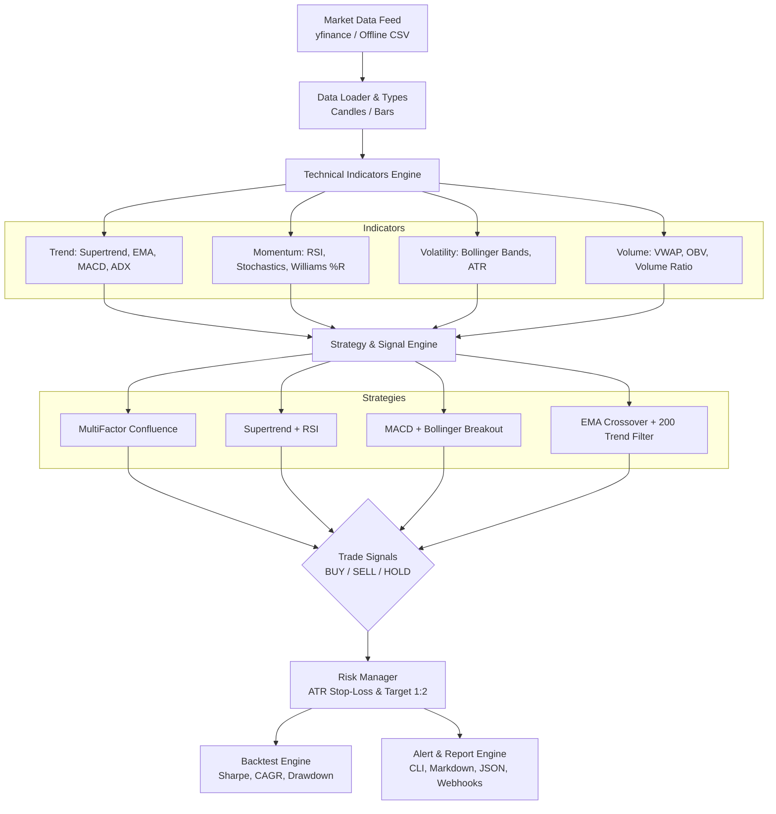

# 📈 Nifty Technical Analysis & Trading Signals

[](https://github.com/kalakriticreations0925-source/nifty-technical-analysis/actions/workflows/ci.yml)
[](https://github.com/kalakriticreations0925-source/nifty-technical-analysis/actions/workflows/daily_signals.yml)
[](https://www.python.org/)
[](LICENSE)
[](https://www.nseindia.com/)

A modular algorithmic technical analysis and trading signal generation engine tailored for the Indian stock market (NIFTY 50, BANK NIFTY, and NSE equities). Combines trend, momentum, volatility, and volume indicators to generate high-probability **BUY** and **SELL** signals with dynamic ATR-based Stop-Loss and Target levels.

---

## 🚀 Key Features

- **Multi-Factor Confluence Engine**: Evaluates Trend (Supertrend, EMAs, ADX), Momentum (RSI, MACD), Volatility (Bollinger Bands %B), and Volume (Volume Surge, OBV) to produce quantified confidence scores ($0\%$ to $100\%$).
- **Indian Market Ready**: Built-in tracking for `^NSEI` (NIFTY 50), `^NSEBANK` (BANK NIFTY), and major NSE bluechips (`RELIANCE`, `TCS`, `HDFCBANK`, `INFY`, etc.).
- **Dynamic Risk Management**: Automatic calculation of Stop-Loss and Target levels based on Average True Range (ATR) with customizable Risk-to-Reward ratios ($1:2$ standard).
- **Event-Driven Backtester**: Simulates historical trading with realistic slippage, brokerage (e.g. ₹20 flat discount broker model), and prints Sharpe, Sortino, CAGR, Max Drawdown, and Win Rate.
- **Zero-Dependency Fallback**: Fully functional out of the box using Python standard library, with accelerated DataFrame support when `pandas` and `yfinance` are installed.
- **Automated GitHub Actions**: Scheduled daily cron job that runs right after Indian market close (15:45 IST / 10:15 UTC) to generate fresh signals and publish markdown reports.
- **Alert Dispatcher**: Integrates with Telegram, Discord webhooks, and markdown/JSON file exporters.

---

## 🏛️ Architecture Overview



---

## 📂 Project Structure

```
nifty-technical-analysis/
├── .github/
│   └── workflows/
│       ├── ci.yml                 # Automated test matrix across Python versions
│       └── daily_signals.yml      # Scheduled daily market close scanner
├── data/
│   ├── sample_nifty50_daily.csv   # Historical daily NIFTY 50 OHLCV data
│   ├── sample_banknifty_daily.csv # Historical daily BANK NIFTY OHLCV data
│   └── nifty50_tickers.json       # Catalog of Indian equities and indices
├── notebooks/
│   └── quickstart.ipynb           # Interactive Jupyter notebook walkthrough
├── src/
│   ├── __init__.py
│   ├── alerts/
│   │   ├── __init__.py
│   │   └── notifier.py            # Terminal tables, Markdown, Webhooks
│   ├── backtest/
│   │   ├── __init__.py
│   │   ├── engine.py              # Event-driven backtester & execution simulator
│   │   └── metrics.py             # CAGR, Sharpe, Sortino, Max Drawdown
│   ├── data/
│   │   ├── __init__.py
│   │   ├── loader.py              # CSV parsing & Yahoo Finance data feed
│   │   └── types.py               # Candle, Signal, TradeRecord dataclasses
│   ├── indicators/
│   │   ├── __init__.py
│   │   ├── momentum.py            # RSI, Stochastic, Williams %R
│   │   ├── trend.py               # Supertrend, EMA/SMA, MACD, ADX, ATR
│   │   ├── volatility.py          # Bollinger Bands, Keltner Channels
│   │   └── volume.py              # VWAP, OBV, Volume Surge Ratio
│   ├── strategies/
│   │   ├── __init__.py
│   │   ├── base.py                # BaseStrategy abstract interface
│   │   ├── confluence.py          # 4-pillar ensemble voting strategy
│   │   ├── ema_crossover.py       # Fast/Slow EMA with 200 EMA filter
│   │   ├── macd_bollinger.py      # Bollinger squeeze & MACD crossover
│   │   └── supertrend_rsi.py      # Supertrend (10,3) + RSI momentum
│   └── cli.py                     # Rich command-line interface
├── tests/
│   ├── __init__.py
│   ├── test_backtester.py         # Backtest accounting and metric tests
│   ├── test_indicators.py         # Technical math verification
│   └── test_strategies.py         # Signal generation tests
├── .env.example                   # Environment configuration template
├── .gitignore                     # Production Git ignore rules
├── LICENSE                        # MIT License
├── pyproject.toml                 # Packaging and build specification
├── requirements.txt               # Dependencies
└── README.md                      # Comprehensive guide
```

---

## ⚡ Quickstart

### 1. Clone & Setup
```bash
git clone https://github.com/kalakriticreations0925-source/nifty-technical-analysis.git
cd nifty-technical-analysis

# Create virtual environment
python -m venv venv
# On Windows:
.\venv\Scripts\activate
# On Linux/macOS:
source venv/bin/activate

# Install dependencies
pip install -r requirements.txt
```

### 2. Scan Market & Generate Signals
Scan NIFTY 50 with the Multi-Factor Confluence Strategy:
```bash
python src/cli.py scan --symbol ^NSEI --strategy confluence
```

Output:
```text
🚀 Scanning Market using Strategy: [MultiFactor_Confluence]

+--------------+--------------+----------+--------------+--------------+--------------+--------+----------+------------------------+
| Symbol       | Timestamp    | Signal   | Price (₹)    | Stop Loss    | Target       | R:R    | Conf.    | Strategy               |
+--------------+--------------+----------+--------------+--------------+--------------+--------+----------+------------------------+
| ^NSEI        | 2026-12-17   | BUY      |   ₹28,754.40 |   ₹28,222.33 |   ₹29,818.54 |    2.0 |      73% | MultiFactor_Confluence |
+--------------+--------------+----------+--------------+--------------+--------------+--------+----------+------------------------+
```

### 3. Run Strategy Backtest
Simulate strategy execution on historical data:
```bash
python src/cli.py backtest --symbol ^NSEI --strategy confluence --capital 100000
```

---

## 📊 Strategies Explained

| Strategy | Primary Indicators | Buy Condition | Sell Condition | Best Suited For |
| :--- | :--- | :--- | :--- | :--- |
| **`confluence`** | Supertrend + EMA + RSI + MACD + BB + Volume | Bullish Confluence Score $\ge 70\%$ | Bearish Confluence Score $\ge 70\%$ | Positional & Swing Trading |
| **`supertrend`** | Supertrend (10, 3) + RSI (14) | Supertrend flips Bullish and $50 \le \text{RSI} \le 75$ | Supertrend flips Bearish and $25 \le \text{RSI} \le 50$ | Trend Following / Momentum |
| **`macd_bb`** | MACD (12, 26, 9) + Bollinger (20, 2) | MACD crosses above Signal and Price $>$ BB Mid | MACD crosses below Signal and Price $<$ BB Mid | Volatility Breakouts |
| **`ema_cross`** | 9 EMA / 21 EMA + 200 EMA Filter | 9 EMA crosses above 21 EMA and Price $>$ 200 EMA | 9 EMA crosses below 21 EMA and Price $<$ 200 EMA | Trend Continuation |

---

## 💻 CLI Command Reference

### Scan All Tracked Equities
Scan all constituent stocks and export reports to JSON and Markdown:
```bash
python src/cli.py scan --symbol ALL --strategy confluence --export-md reports/DAILY_SIGNALS.md --export-json reports/signals.json
```

### Backtest Options
```bash
# Backtest Supertrend on Bank Nifty with ₹200,000 initial capital
python src/cli.py backtest --symbol ^NSEBANK --strategy supertrend --capital 200000 --export-md reports/BACKTEST.md

# Long-only mode (no shorting)
python src/cli.py backtest --symbol ^NSEI --strategy confluence --long-only
```

### Inspect Strategies & Tickers
```bash
python src/cli.py list-strategies
python src/cli.py list-tickers
```

---

## 🧪 Testing

Run unit tests across all indicators, strategies, and backtesting metrics:
```bash
python -m unittest discover -s tests -v
# Or with pytest:
pytest tests/ -v
```

---

## 🌐 Pushing to Your GitHub Account

To publish this repository to your GitHub account:

1. Create a new empty repository on [GitHub](https://github.com/new) named `nifty-technical-analysis`.
2. Connect the remote and push:
```bash
# Add your GitHub repository remote URL
git remote add origin https://github.com/<your-username>/nifty-technical-analysis.git

# Rename main branch (if needed) and push
git branch -M main
git push -u origin main
```

---

## ⚠️ Disclaimer

*This software is developed for educational, research, and algorithmic analysis purposes only. Stock market trading involves substantial risk of loss. Past performance of any indicator or strategy does not guarantee future results. Never risk more capital than you can afford to lose. Always perform your own due diligence or consult a SEBI-registered financial advisor before executing trades.*
